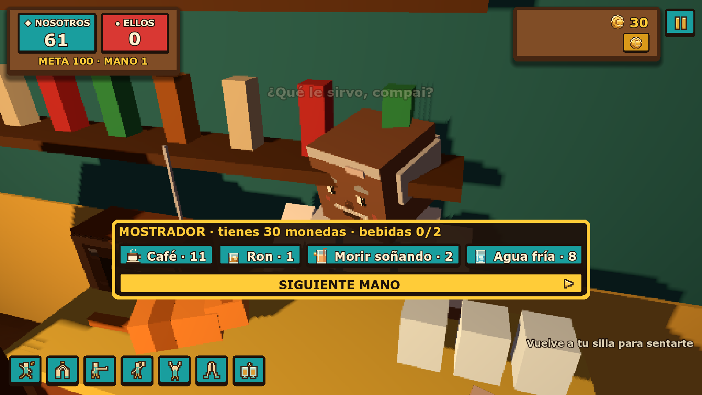

# Colmadón 🁫

**Dominó dominicano por parejas en un colmado 3D con estética pixel art, multijugador online con servidor autoritativo.**




## Qué es

Cuatro jugadores se sientan alrededor de una mesa en un colmado nocturno y juegan dominó por parejas con las reglas dominicanas. Entre manos, cada jugador elige un aumento y gasta lo que gana en bebidas que alteran las reglas, lo que añade una capa *roguelite* a un juego clásico.

Las partidas no se quedan en la mesa. Puedes levantarte, caminar por el colmado, chocar manos, brindar o bailar con los demás jugadores en tiempo real.

## Aspectos técnicos destacados

- **Render 3D en baja resolución (640×360) ampliado sin suavizado**, con las fichas dibujadas en alta definición encima para que se lean bien.
- **Servidor autoritativo con [Nakama](https://heroiclabs.com/nakama/)** (módulo en TypeScript): el servidor valida cada jugada, así nadie puede hacer trampa desde el cliente.
- **Salas privadas con código de 6 caracteres**, reconexión a la partida durante 3 horas y bots que ocupan las sillas vacías o de los jugadores ausentes.
- **Bots con reglas reales del dominó dominicano**: «¡Ute va!» con revisión, renuncio, tranque y capicúa.
- **Bot de QA automático** que recorre el juego, captura fotogramas y comprueba invariantes de la interfaz y de las reglas.
- **Más de 100 pruebas automatizadas** en GDScript (`tests/`).
- **Juego cruzado** entre PC y Android, con interfaz en español e inglés.

## Estructura

```
scripts/      Lógica del juego, red, interfaz y bots (GDScript)
servidor/     Servidor Nakama: reglas autoritativas (TypeScript) y scripts de despliegue
tests/        Pruebas automatizadas
tools/        Bot de recorrido y herramientas de QA
arte/         Personajes, escenario e interfaz
docs/         Diseño, reglas de interacción, accesibilidad y equilibrio
```

## Ejecutar

1. Abre `project.godot` con Godot 4.
2. Para jugar online en local, arranca el servidor con `servidor/arrancar.sh`.
3. Pulsa **F5**.

## Estado

🟢 En desarrollo activo.

Más detalles del diseño en [DISENO.md](DISENO.md).

---
Desarrollado por **[Cukiti](https://github.com/Cukiti)**.
